<div align="center">

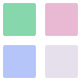

# Mosaic

### Uma loja de pacotes para o Arch Linux, com a cara do seu wallpaper.

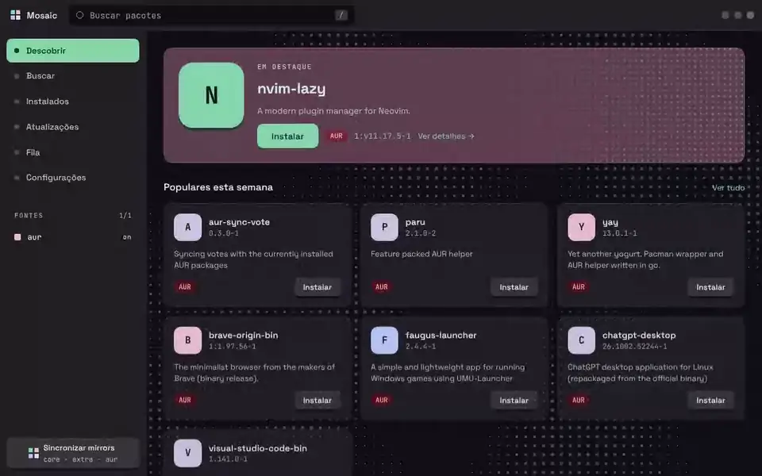

<sub><a href="assetsReadme/mosaic-showcase.mp4">Ver o vídeo em qualidade cheia</a></sub>

<p>
  <a href="#o-que-é">O que é</a> ·
  <a href="#telas">Telas</a> ·
  <a href="#novidades">Novidades</a> ·
  <a href="#o-que-ainda-falta">O que falta</a> ·
  <a href="#rodando-localmente">Rodando localmente</a> ·
  <a href="#tema-com-o-matugen">Tema</a>
</p>

</div>

> [!NOTE]
> **Sobre o uso de IA.**
> - **Grande parte do front-end deste projeto (HTML, CSS e JavaScript) foi escrita com a ajuda de IA. A paleta de cores e o sistema de temas a partir do wallpaper, o layout das telas e o nome são meus, e a identidade visual foi conduzida por mim: a direção de arte, o que entrou, o que saiu e o que precisou ser refeito até ficar com a cara que eu queria.**
> - **Sistema de versionamento, alem do auxilio para criação do [README.md](README.md).**
> - **Criação dos motions graphics e videos utilizando Claude Opus 5.5**

## O que é

O Mosaic coloca o `paru` atrás de uma interface calma, rápida e legível. Busca, detalhes da AUR, PKGBUILD, instalação e a saída do build ficam no mesmo fluxo, sem abrir terminal.

<table>
  <tr>
    <td width="33%" valign="top">
      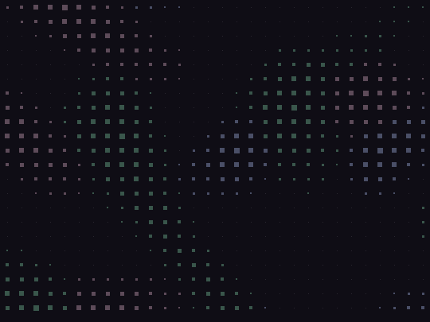<br>
      <strong>Descobrir</strong><br>
      <sub>Destaque e pacotes populares e mais votados da AUR.</sub>
    </td>
    <td width="33%" valign="top">
      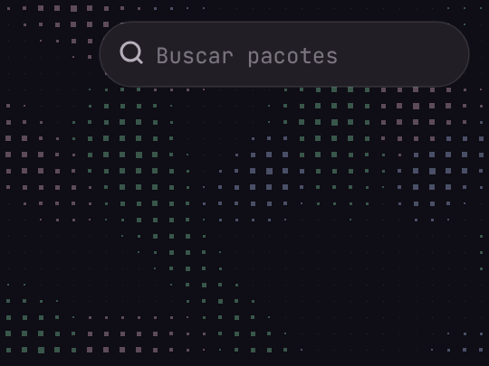<br>
      <strong>Buscar</strong><br>
      <sub>AUR e repositórios oficiais numa busca só, local e instantânea.</sub>
    </td>
    <td width="33%" valign="top">
      <br>
      <strong>Instalar com contexto</strong><br>
      <sub>Aviso de pacote da AUR, PKGBUILD, dependências e o build ao vivo.</sub>
    </td>
  </tr>
</table>

## Telas

<table>
  <tr>
    <td width="50%">
      <strong>Descobrir</strong><br>
      <sub>Destaque, populares e mais votados da AUR, e um aviso quando tem atualização.</sub><br><br>
      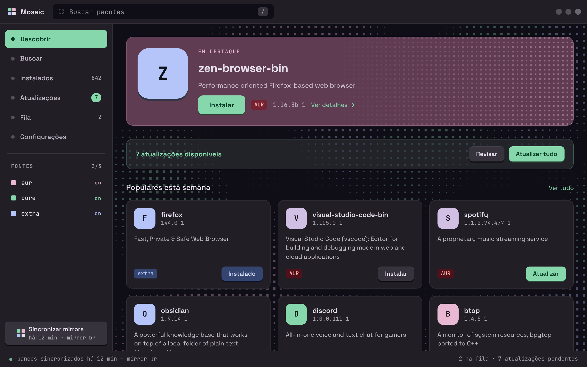
    </td>
    <td width="50%">
      <strong>Buscar</strong><br>
      <sub>A tela vazia, antes da primeira busca. A tecla <kbd>/</kbd> traz para cá de qualquer lugar.</sub><br><br>
      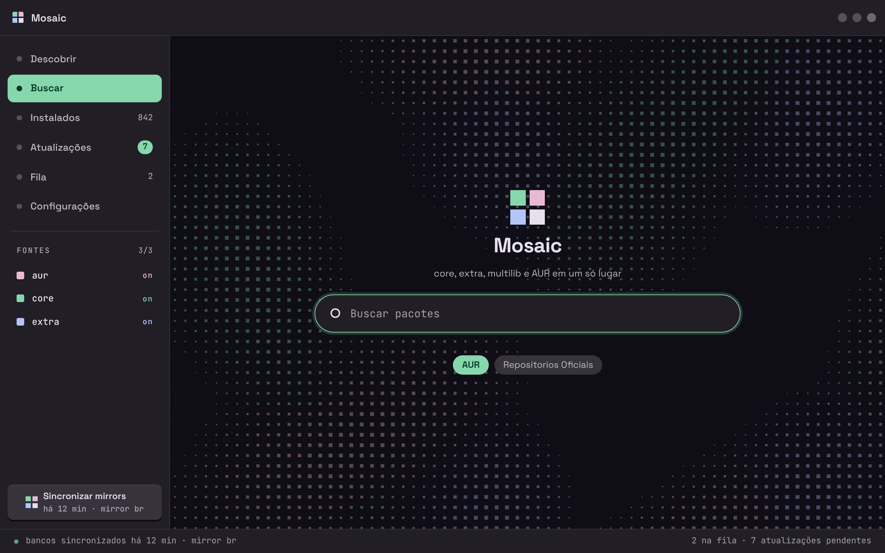
    </td>
  </tr>
  <tr>
    <td>
      <strong>Resultados</strong><br>
      <sub>Versão, votos e de onde vem cada pacote. O que é da AUR fica marcado.</sub><br><br>
      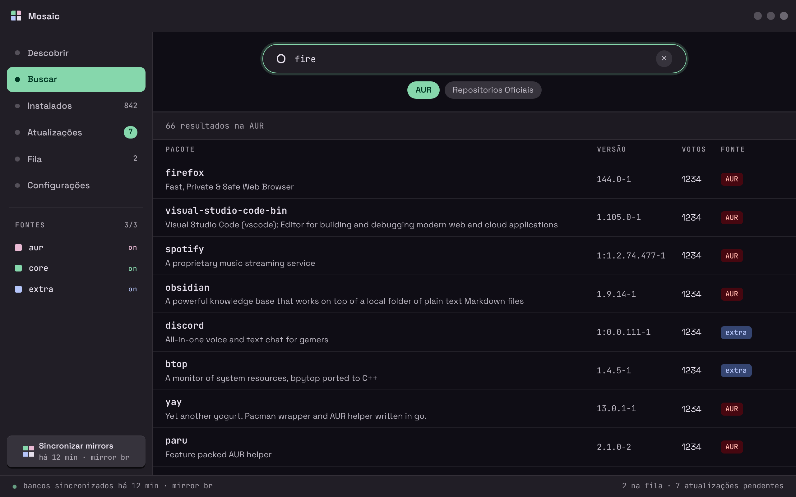
    </td>
    <td>
      <strong>Pacote</strong><br>
      <sub>O aviso da AUR, as dependências e o PKGBUILD antes de instalar.</sub><br><br>
      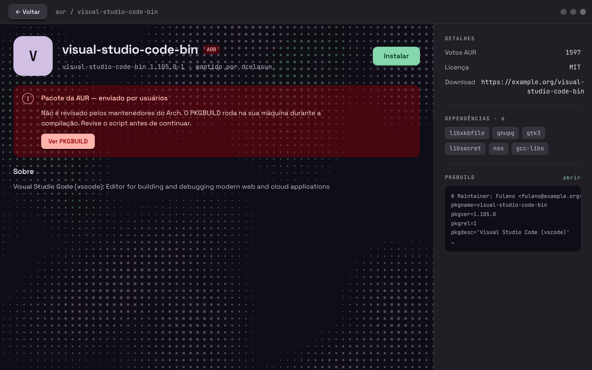
    </td>
  </tr>
  <tr>
    <td>
      <strong>Instalados</strong><br>
      <sub>Tudo que o pacman tem instalado, com versão e tamanho. Dá para filtrar por fonte ou por nome.</sub><br><br>
      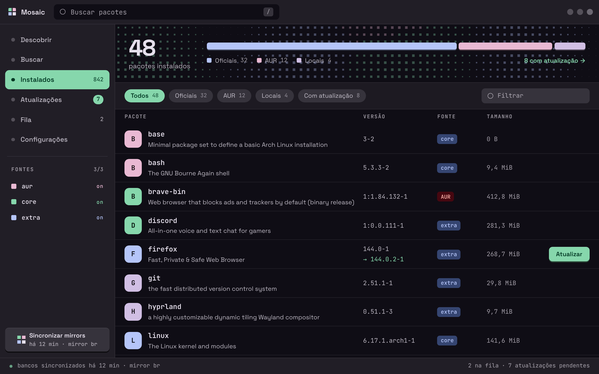
    </td>
    <td>
      <strong>Atualizações</strong><br>
      <sub>O que o <code>checkupdates</code> e o <code>paru -Qua</code> acharam, separado entre oficiais e AUR.</sub><br><br>
      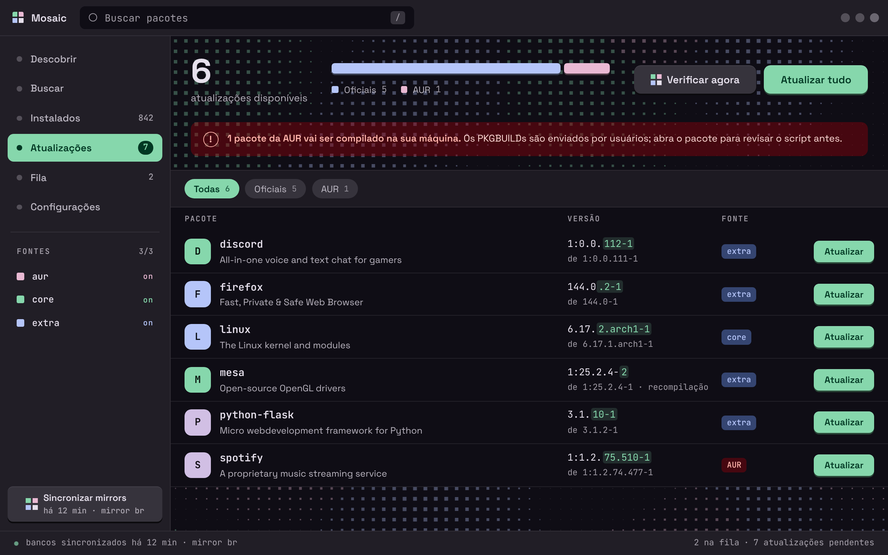
    </td>
  </tr>
  <tr>
    <td>
      <strong>Atualizando o sistema</strong><br>
      <sub>O <code>pacman -Syu</code> rodando, com as etapas e a saída ao vivo. Dá para sair da tela e voltar depois.</sub><br><br>
      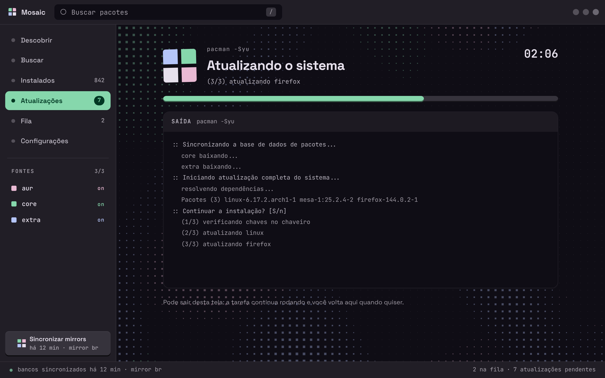
    </td>
    <td>
      <strong>Fila</strong><br>
      <sub>Um pacote por vez, com a saída do build ao lado.</sub><br><br>
      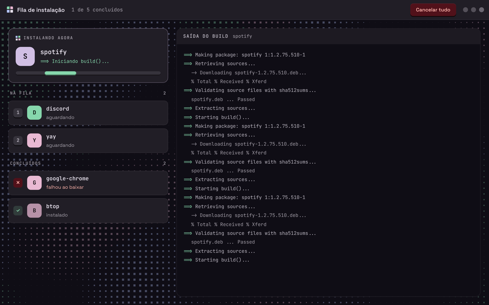
    </td>
  </tr>
  <tr>
    <td>
      <strong>Configurações</strong><br>
      <sub>As cores que vieram do Matugen e as opções da loja.</sub><br><br>
      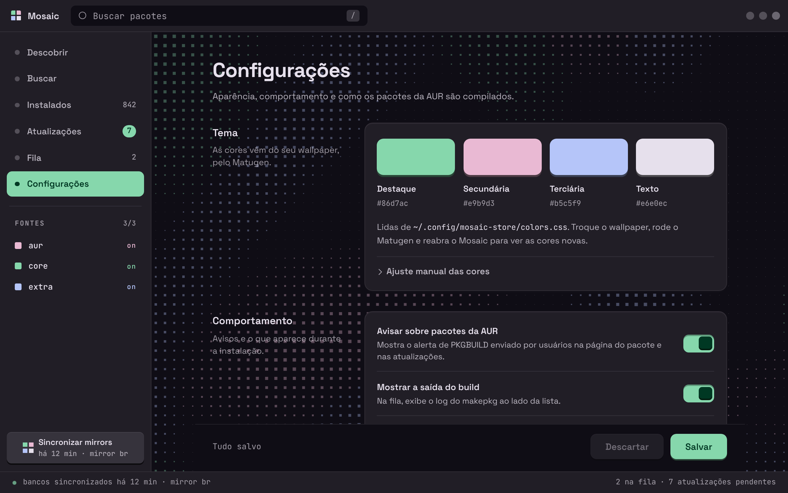
    </td>
    <td>
      <strong>Esperando uma tela</strong><br>
      <sub>Quando a próxima tela demora, o conteúdo é coberto e mostra o que está carregando.</sub><br><br>
      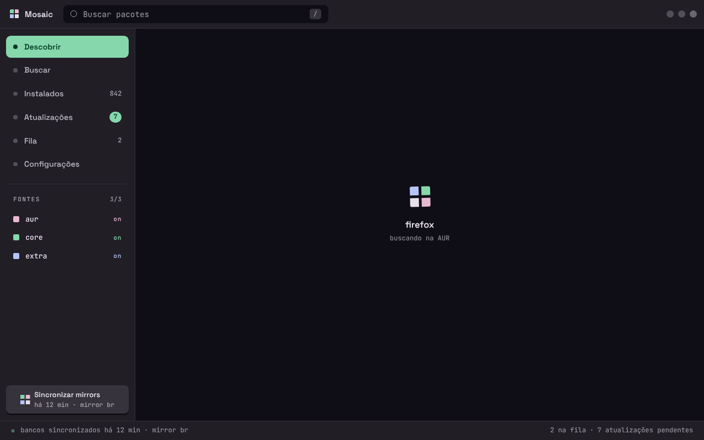
    </td>
  </tr>
</table>

<sub>As capturas usam dados de exemplo. Os números da barra lateral (instalados, atualizações, fila) ainda não vêm do sistema, veja <a href="#o-que-ainda-falta">o que ainda falta</a>.</sub>


## Novidades

As últimas versões mexeram mais no app em volta da loja do que na loja em si:

- **Instalados e Atualizações funcionam de verdade.** A lista vem do pacman, e as atualizações do `checkupdates` e do `paru -Qua`. "Atualizar tudo" roda o `pacman -Syu` numa tela própria, e "Sincronizar mirrors" também.
- **Tela de espera.** Antes, clicar numa tela lenta (Instalados lendo o pacman, por exemplo) deixava a janela parada. Agora o conteúdo é coberto na hora e diz o que está vindo. <kbd>Esc</kbd> desiste.
- **Abertura.** A janela já abre na cor do tema, com a marca girando, em vez de um retângulo branco até a loja carregar.
- **Mosaic UI.** O visual saiu da loja e virou uma biblioteca em [`mosaic-ui/`](mosaic-ui/), para servir a outros apps.
- **Pacote para o Arch.** Tem PKGBUILD em `pkg/`, comando `mosaic-store`, ícone e atalho no menu.
- **Versões.** O app agora tem número de versão, CHANGELOG e um script para lançar versão nova.

A lista completa está no [CHANGELOG.md](CHANGELOG.md).

## Funcionalidades

- Busca local em SQLite com full-text na AUR, core e extra, ordenada por correspondência e popularidade.
- Página do pacote com dependências, votos, mantenedor, link do projeto e PKGBUILD da AUR.
- Instalação em fila com o `paru`, um pacote por vez, e a saída do build ao vivo, sem recarregar a página.
- Lista de instalados com versão e tamanho.
- Atualizações dos repositórios oficiais e da AUR, e atualização completa do sistema com o `pacman -Syu`.
- Sincronização dos bancos do pacman.
- Tema gerado a partir do wallpaper pelo Matugen.
- Atalho <kbd>/</kbd> para ir direto à busca.
- Movimento reduzido respeitado: as animações viram fades curtos e o fundo fica parado.

## O que ainda falta

Os botões abaixo já estão na tela, mas ainda não fazem nada:

- Remover um pacote, na tela de Instalados.
- Atualizar um pacote só. Por enquanto, só o "Atualizar tudo" funciona.
- Cancelar um pacote da fila, ou a fila inteira.
- Salvar as Configurações.
- Ligar e desligar as fontes (aur, core, extra) pela barra lateral.

E o que ainda não existe:

- Contagens reais na barra lateral e no rodapé.
- Categorias no Descobrir. A tela já tem o espaço, falta de onde tirar os dados.
- Um destaque que mude. Hoje é sempre o mesmo pacote.
- O repositório multilib no banco local.
- Builds com limite de CPU e memória, para um build pesado não travar a máquina.
- Publicar na AUR. O cadastro de contas está fechado no momento, então por enquanto a instalação é pelo PKGBUILD daqui.

## Stack

| Camada | Tecnologia |
| --- | --- |
| Backend | Python + Flask |
| Interface desktop | pywebview (Qt WebEngine) |
| Pacotes | paru, pacman, AUR e repositórios oficiais |
| Dados | SQLite + busca full-text (FTS5) |
| Interface | HTML, CSS e JavaScript, sem framework, com a [Mosaic UI](mosaic-ui/); canvas num Web Worker |
| Fontes | Space Grotesk e JetBrains Mono, servidas localmente |
| Empacotamento | PKGBUILD (`pkg/`) |

## Rodando localmente

Instale as ferramentas do Arch necessárias para compilar pacotes da AUR:

```bash
sudo pacman -S --needed base-devel python-setuptools paru
```

Crie o ambiente e instale as dependências:

```bash
python -m venv venv
source venv/bin/activate
pip install -r requirements.txt
```

Abra a aplicação desktop:

```bash
python app.py --janela
```

Para testar só as telas no navegador durante o desenvolvimento (o Flask em `http://127.0.0.1:5000`):

```bash
python app.py
```

## Instalando

Com o PKGBUILD da pasta `pkg/`, o Mosaic vira um pacote do sistema, com o comando `mosaic-store` e o atalho no menu:

```bash
cd pkg
makepkg -si
```

O banco de pacotes e os downloads ficam em `~/.cache/mosaic-store`. Na primeira vez que abre, o app baixa a lista da AUR e dos repositórios, e o Descobrir fica vazio até terminar.

## Tema com o Matugen

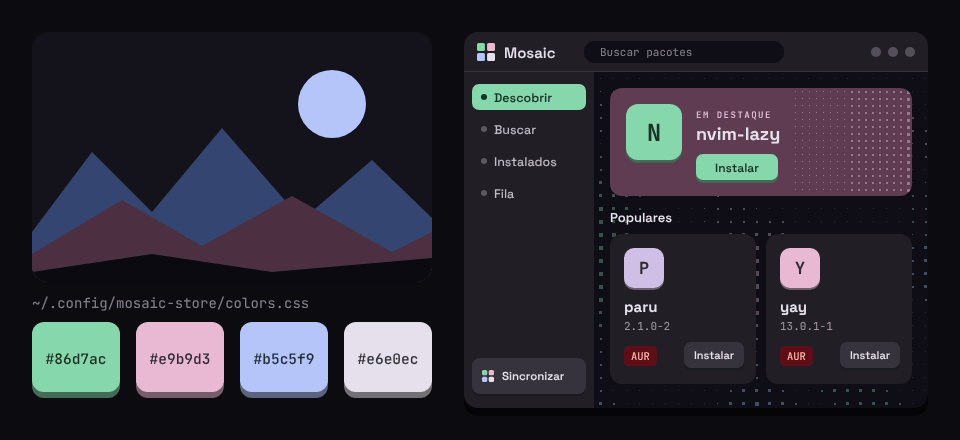

O Mosaic lê as cores de `~/.config/mosaic-store/colors.css`. Aponte um template do Matugen para esse arquivo:

```toml
# ~/.config/matugen/config.toml
[templates.mosaic]
input_path = "~/.config/matugen/templates/mosaic.css"
output_path = "~/.config/mosaic-store/colors.css"
```

O template é um bloco `:root` com as variáveis de cor do app. A lista completa, com os valores padrão, está em [`mosaic-ui/css/tokens.css`](mosaic-ui/css/tokens.css), a camada de tokens da Mosaic UI, que todo app do ecossistema usa. Sem o arquivo, o Mosaic usa esses valores padrão.

O ícone do app também segue essas cores. Toda vez que o Mosaic abre (ou carrega o tema de novo), ele monta o ícone em SVG com as cores do `colors.css` e grava em `~/.local/share/icons/hicolor/scalable/apps/mosaic-store.svg`, que tem prioridade sobre o ícone que vem no pacote. Alguns menus e barras de tarefas só mostram o ícone novo quando recarregam os ícones.

## Versões

O que mudou em cada versão está no [CHANGELOG.md](CHANGELOG.md). Como os commits são escritos e como lançar uma versão nova, no [VERSIONAMENTO.md](VERSIONAMENTO.md).

## Licença

[GPL-3.0-or-later](LICENSE).

## Créditos

Space Grotesk e JetBrains Mono são distribuídas sob a SIL Open Font License 1.1 (licenças em [`mosaic-ui/fontes`](mosaic-ui/fontes)).
